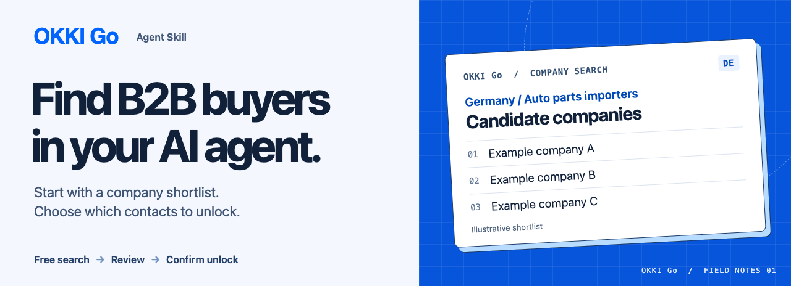
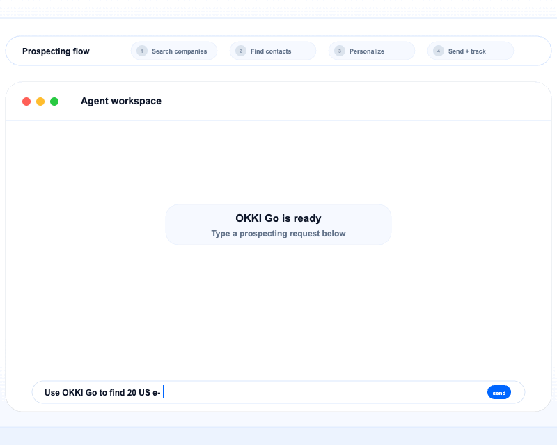

# OKKI Go

**English** · [简体中文](./README.zh-CN.md) · [繁體中文（台灣）](./README.zh-TW.md)



OKKI Go is a B2B prospecting skill for sales teams using Claude Code, Cursor, Codex and other AI agents. Describe the companies you want to reach and review a shortlist for free. Choose which companies to unlock with credits to see available business contacts. Your agent asks before a paid unlock or an email send.

[① Install the skill](#install-the-skill) → [② Sign up and get your API key](#sign-up-and-get-your-api-key) → [③ Configure your agent](#let-your-agent-set-it-up) → [④ Run your first search](#run-your-first-search)

<a name="install-the-skill"></a>

## 📦 Install the skill

**Choose one** of these two ways to install the skill.

### 1. 💻 Install from your terminal

If Node.js and npm are installed, run this command, then choose your agent and installation location when prompted:

```sh
npx -y @okki-global/okki-go@latest
```

### 2. 🤖 Ask your agent to install it

For **Codex**, send this message:

> Run `npx -y @okki-global/okki-go@latest --global --codex` to install the OKKI Go skill for me.

Using another agent? Select your platform on the [install page](https://go.okki.ai/install) and send the matching command to your agent.

<a name="sign-up-and-get-your-api-key"></a>

## 🔑 Sign up and get your API key

**Already signed up but don’t have an API key?** [Open your dashboard](https://go.okki.ai/dashboard) and select **Create Key** under **API Key**. You don’t need to sign up again.

Already have a key? [Go straight to agent setup](#let-your-agent-set-it-up). New to OKKI Go? Choose a sign-up option below.

**🤖 Sign up with your agent:** Ask: “Help me sign up for OKKI Go, create an API key and set it up.” Review and accept the terms, then verify your email when prompted.

**🌐 Sign up manually:**

1. [Sign up on the website](https://go.okki.ai/register). If your full API key appears, copy it. Otherwise, [open the dashboard](https://go.okki.ai/dashboard) and find **API Key**.
2. No key yet? Select **Create Key**, enter a name (such as `Cursor`), then select **Create Key** again. If you already have a key, select **Show** instead.
3. Copy the full API key and return to the agent where you installed the skill. Ask it to finish setup for you.

<a name="let-your-agent-set-it-up"></a>

## 🔧 Let your agent set it up

**Did your agent confirm setup is complete?** [Run your first search](#run-your-first-search). If you got your key on the website or your agent says it still needs setup, send this message:

> Set up OKKI Go with this API key and let me know when it’s ready.

When prompted, paste your key into the agent’s key field or secure local prompt. If your agent just created the key, skip the paste. Once your agent confirms setup, you’re ready to search for companies.

<a name="run-your-first-search"></a>

## 🔍 Run your first search

Once your agent has finished setup, ask: “Find automotive parts importers in Germany. Show me the companies first. Don’t unlock contacts or send email.” If there are matches, you’ll get a shortlist to review. This search doesn’t spend unlock credits or send email.

## 🎬 Official product demo



The agent conversation below is the demo used on the OKKI Go website. The cover uses an illustrative shortlist, not live search results.

## ✉️ From shortlist to outreach

| What you want to do | What to ask next |
| --- | --- |
| Review a shortlist | “Which of these companies look like importers rather than manufacturers? Explain your picks using the results we have.” |
| Find contacts at selected companies | “I’m interested in rows 1 and 3. Show me the credit cost before unlocking them.” |
| Prepare outreach | “Draft an introductory email for the first selected company using the information we have. Don’t send it.” |

Contact availability varies by company. Sending is a separate, confirmed action that requires an eligible plan; see [pricing](https://go.okki.ai/pricing). After a send you can ask the agent to check delivery status.

## 📚 Setup and reference

- [Official install guide](https://go.okki.ai/install) — agent-specific commands, API key setup and troubleshooting.
- [Skill workflows](https://github.com/okki-op/okki-go/blob/main/skill/SKILL.md) · [API reference](https://github.com/okki-op/okki-go/blob/main/skill/references/api-reference.md) — technical behavior and supported operations.
- [npm package](https://www.npmjs.com/package/@okki-global/okki-go) · [OKKI Go website](https://go.okki.ai/).
- Need help installing the skill or configuring your API key? Email OKKI Go support at [go@okki.ai](mailto:go@okki.ai).

**Package license:** MIT.
