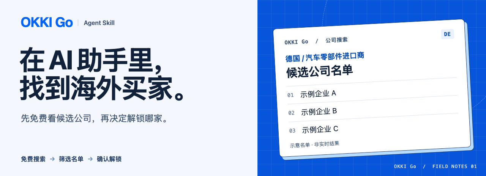
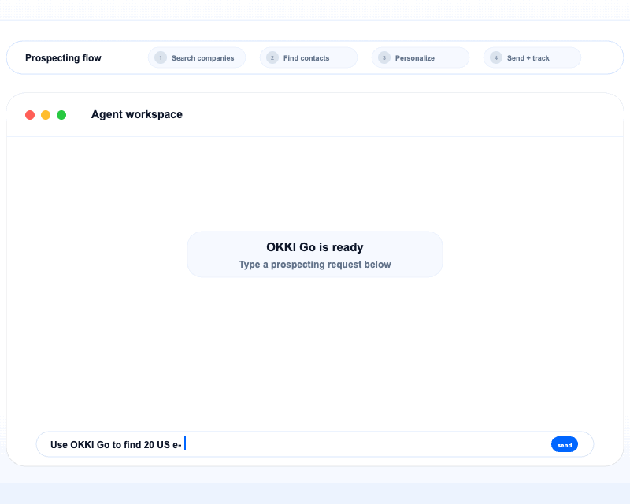

# OKKI Go

[English](./README.md) · **简体中文** · [繁體中文（台灣）](./README.zh-TW.md)



OKKI Go 是面向 B2B 销售和外贸团队的获客 Skill，可在 Claude Code、Cursor、Codex 等 AI 助手中使用。告诉它你想找哪类公司，就能先免费看候选名单。看中哪家，再用积分解锁哪家，查看可用的业务联系人。扣积分或发送邮件前，助手都会先请你确认。

[① 安装 Skill](#安装-skill) → [② 注册并获取 API Key](#注册并获取-api-key) → [③ 交给 Agent 配置](#让-agent-帮我配置) → [④ 搜索公司](#试一次公司搜索)

<a name="安装-skill"></a>

## 📦 安装 Skill

以下两种方式，**选一种即可**。

### 1. 💻 在终端安装

电脑已安装 Node.js 和 npm？在终端运行下面的命令，再按提示选择 Agent 和安装位置：

```sh
npx -y @okki-global/okki-go@latest
```

### 2. 🤖 直接让 Agent 安装

以 **Codex** 为例，把这句话发给它：

> 请执行 `npx -y @okki-global/okki-go@latest --global --codex` 帮我安装 OKKI Go Skill。

使用其他 Agent？在[官网安装页](https://go.okki.ai/install)选择你的平台，把对应命令发给它即可。

<a name="注册并获取-api-key"></a>

## 🔑 注册并获取 API Key

**已注册，还没有 API Key？** [打开控制台](https://go.okki.ai/dashboard)，在「API 密钥」下点「创建 Key」。不用重新注册。

已有 Key？[直接让 Agent 帮你配置](#让-agent-帮我配置)。还没有账号？选下面一种方式注册。

**🤖 让 Agent 帮你注册：** 告诉它：「请帮我注册 OKKI Go，生成 API Key 并完成配置。」按提示阅读并同意条款、验证邮箱即可。

**🌐 手动注册：**

1. [到官网注册](https://go.okki.ai/register)。如果页面已显示完整的 API Key，直接复制；否则[打开控制台](https://go.okki.ai/dashboard)，找到 **API 密钥**。
2. 没有 Key？点 **创建 Key**，填个名称（例如 `Cursor`），再点一次 **创建 Key**。已有 Key？点 **显示**，不用重新创建。
3. 复制完整的 API Key，回到刚才安装 Skill 的 Agent，让它帮你配置。

<a name="让-agent-帮我配置"></a>

## 🔧 让 Agent 帮我配置

**Agent 已经提示配置完成？** [直接开始搜索](#试一次公司搜索)。如果你是在官网拿到 Key，或 Agent 提示还没配置，把下面这句话发给它：

> 请用这个 API Key 帮我配置 OKKI Go，配好后告诉我。

按 Agent 的提示，在密钥输入框或本机安全输入处粘贴 Key。如果 Key 是 Agent 刚帮你生成的，就不用再贴。等它确认配置完成，就可以开始找公司了。

<a name="试一次公司搜索"></a>

## 🔍 试一次公司搜索

如果 Agent 已完成配置，直接发给它：「帮我找德国的汽车零部件进口商。先列公司，不解锁联系人，也不发邮件。」有匹配结果时，你会看到候选名单；到这一步不会扣解锁积分，也不会发信。

## 🎬 官方产品演示



下方是 OKKI Go 官网使用的 Agent 对话演示。封面名单仅作示意，不代表实际查询结果。

## ✉️ 拿到名单后，可以怎样继续？

| 你的下一步 | 可以这样问 |
| --- | --- |
| 筛出更像买家的公司 | 「根据这批结果，哪些更像进口商，哪些可能是生产商？说说判断依据。」 |
| 查指定公司的联系人 | 「我想看第 1 家和第 3 家的联系人。先告诉我解锁需要多少积分。」 |
| 准备第一封开发信 | 「根据已有资料，帮我给第一家选中的公司起草一封英文开发信。先给我看，不要发送。」 |

各家公司可查到的联系人有所不同。实际发送需要支持发信的套餐，并单独确认；详见[套餐说明](https://go.okki.ai/pricing)。发出后，可以继续让助手查询投递状态。

## 📚 安装与技术文档

- [官网安装指南](https://go.okki.ai/install)：各平台安装命令、API Key 配置与常见问题。
- [仓库中文安装手册](https://github.com/okki-op/okki-go/blob/main/INSTALL.md)：从源码安装、自定义目录及运行时设置。
- [Skill 工作流程](https://github.com/okki-op/okki-go/blob/main/skill/SKILL.md) · [API 参考](https://github.com/okki-op/okki-go/blob/main/skill/references/api-reference.md)：面向开发者的技术文档，含英文内容。
- [npm 软件包](https://www.npmjs.com/package/@okki-global/okki-go) · [OKKI Go 官网](https://go.okki.ai/)。
- 安装或配置 API Key 遇到问题？联系 OKKI Go 支持：[go@okki.ai](mailto:go@okki.ai)。

**软件包许可证：** MIT。
