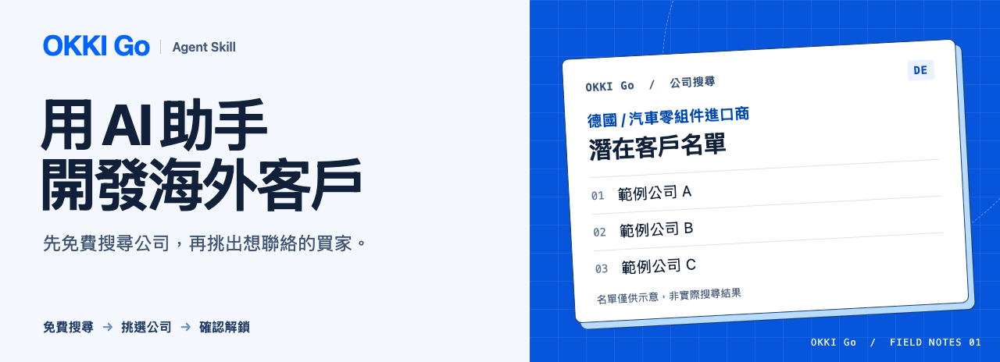
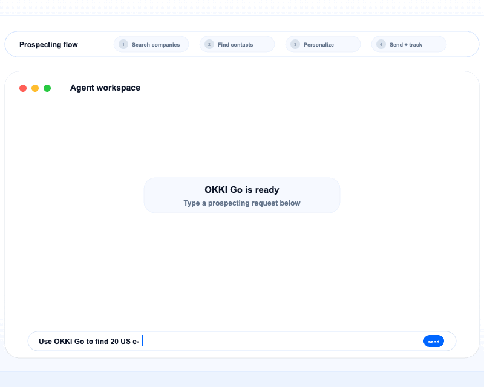

# OKKI Go

[English](./README.md) · [简体中文](./README.zh-CN.md) · **繁體中文（台灣）**



OKKI Go 是給 B2B 業務和外貿團隊用的客戶開發工具，可以當作 Skill 安裝在 Claude Code、Cursor 或 Codex 等 AI 助手裡。告訴助手你想找哪個市場、哪一類買家，就能免費搜尋公司。看到想進一步了解的公司，再用點數解鎖，查看現有的聯絡人資料。扣點或寄信前，助手都會先跟你確認。

[① 安裝 Skill](#安裝-skill) → [② 註冊並取得 API 金鑰](#註冊並取得-api-金鑰) → [③ 請助手設定](#請-ai-助手幫我設定) → [④ 搜尋公司](#開始搜尋公司)

<a name="安裝-skill"></a>

## 📦 安裝 Skill

以下兩種方式，**擇一即可**。

### 1. 💻 在終端機安裝

電腦已安裝 Node.js 和 npm？在終端機執行以下指令，再依提示選擇 AI 助手和安裝位置：

```sh
npx -y @okki-global/okki-go@latest
```

### 2. 🤖 直接請 AI 助手安裝

以 **Codex** 為例，把這句話貼給它：

> 請執行 `npx -y @okki-global/okki-go@latest --global --codex` 幫我安裝 OKKI Go Skill。

使用其他助手？到[官網安裝頁](https://go.okki.ai/install)選擇你的平台，再將對應的指令貼給助手即可。

<a name="註冊並取得-api-金鑰"></a>

## 🔑 註冊並取得 API 金鑰

**已經註冊，還沒有 API 金鑰？** [前往控制台](https://go.okki.ai/dashboard)，在「API Key」區塊點選「Create Key」，不用再註冊一次。

手邊已有金鑰？[直接請助手幫你設定](#請-ai-助手幫我設定)。還沒有帳號？選擇以下其中一種方式註冊。

**🤖 請助手幫你註冊：** 告訴它：「請幫我註冊 OKKI Go，建立 API 金鑰並完成設定。」依提示閱讀並同意條款，再完成信箱驗證即可。

**🌐 手動註冊：**

1. [前往官網註冊](https://go.okki.ai/register)。如果畫面已顯示完整的 API 金鑰，直接複製；否則請到[控制台](https://go.okki.ai/dashboard)找到 **API Key**。
2. 還沒有金鑰？點選 **Create Key**，輸入名稱（例如 `Cursor`），再點一次 **Create Key**。已有金鑰？點選 **Show** 即可，不必另外建立。
3. 複製完整的 API 金鑰，回到剛才安裝 Skill 的助手，請它幫你設定。

<a name="請-ai-助手幫我設定"></a>

## 🔧 請 AI 助手幫我設定

**助手已經告訴你設定好了？** [直接開始搜尋](#開始搜尋公司)。如果你是在官網取得金鑰，或助手提示尚未設定，把這句話貼給它：

> 請用這把 API 金鑰幫我設定 OKKI Go，設定好後告訴我。

依助手提示，在金鑰欄位或本機的安全輸入處貼上金鑰。如果金鑰是助手剛幫你建立的，就不用再貼一次。等助手確認設定完成，就可以開始找公司了。

<a name="開始搜尋公司"></a>

## 🔍 開始搜尋公司

助手設定完成後，就可以問：「幫我找德國的汽車零組件進口商。先列出公司讓我挑，不用解鎖聯絡資料，也先不要寄信。」有符合條件的公司時，助手會列出名單；搜尋公司不會扣點，也不會寄出開發信。

## 🎬 產品操作示範



這段動畫取自 OKKI Go 官網，示範如何在 AI 助手裡開發客戶。封面上的公司名單僅供示意。

## ✉️ 有了名單，接下來可以做什麼？

| 想做的事 | 可以這樣問助手 |
| --- | --- |
| 挑出值得聯絡的買家 | 「從這份名單來看，哪些公司比較像進口商？哪些可能是製造商？你是怎麼判斷的？」 |
| 查詢特定公司的聯絡人 | 「我對第 1 家和第 3 家有興趣。解鎖這兩家的聯絡資料要用多少點數？等我確認再解鎖。」 |
| 寫第一封開發信 | 「請用現有資料，幫我寫一封英文開發信給我選的第一家公司。先讓我看草稿，不要寄出。」 |

每家公司能查到的聯絡人資料不盡相同。若要寄出開發信，請先確認[你的方案支援寄信](https://go.okki.ai/pricing)。助手會在寄出前再次跟你確認，寄出後也可以請它查詢投遞狀態。

## 📚 安裝與技術文件

- [官網安裝指南](https://go.okki.ai/install)：查看各平台的安裝指令、API 金鑰設定方式與常見問題。
- [進階安裝手冊（簡體中文）](https://github.com/okki-op/okki-go/blob/main/INSTALL.md)：從原始碼安裝、自訂安裝目錄，以及各平台的設定方式。
- [Skill 運作流程](https://github.com/okki-op/okki-go/blob/main/skill/SKILL.md) · [API 參考文件](https://github.com/okki-op/okki-go/blob/main/skill/references/api-reference.md)：提供給開發者的技術說明，含英文內容。
- [npm 套件](https://www.npmjs.com/package/@okki-global/okki-go) · [OKKI Go 官網](https://go.okki.ai/)。
- 安裝或設定 API 金鑰時遇到問題？請來信洽詢 OKKI Go 支援團隊：[go@okki.ai](mailto:go@okki.ai)。

**套件授權條款：** MIT。
